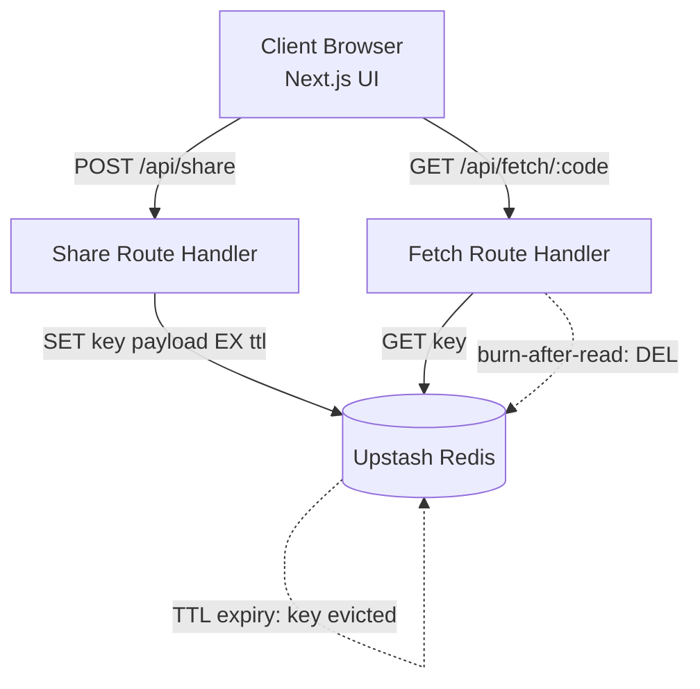

<div align="center">


# ShareBin

**Ephemeral code, text and file sharing. No accounts, no permanent storage.**

[](https://nextjs.org/)
[](https://tailwindcss.com/)
[](https://upstash.com/)
[](https://www.netlify.com/)

[**Live Demo**](https://sharebin-io.netlify.app) · [Architecture](#architecture) · [API](#api-reference) · [Getting Started](#getting-started) · [Roadmap](#roadmap)

</div>

---

## Table of Contents

- [Overview](#overview)
- [Features](#features)
- [Tech Stack](#tech-stack)
- [Architecture](#architecture)
- [API Reference](#api-reference)
- [Design Decisions](#design-decisions)
- [Security Considerations](#security-considerations)
- [Known Limitations](#known-limitations)
- [Project Structure](#project-structure)
- [Getting Started](#getting-started)
- [Configuration](#configuration)
- [Deployment](#deployment)
- [Roadmap](#roadmap)
- [Author](#author)
- [License](#license)

---

## Overview

ShareBin is a serverless, full-stack sharing tool for moving snippets, text and small files between people or devices without sign-up friction. Every share is stored with a TTL (1 to 10 minutes) and can optionally be destroyed after its first view. When the timer ends, the data is gone.

The problem it solves: pastebins and file hosts accumulate data forever, and most require accounts. ShareBin treats shared data as **transient by default**, so expiry is enforced by the datastore itself rather than by application cleanup jobs.

## Features

| Capability | Detail |
|---|---|
| **Zero-auth sharing** | Paste or upload and get a link. No login, no signup. |
| **Configurable TTL** | 1 to 10 minute expiry, enforced natively by Redis. |
| **Burn after read** | Optional deletion on first retrieval. |
| **File and media support** | Uploads up to 10 MB, with re-upload before publishing. |
| **Syntax detection** | Client-side language inference for pasted code. |
| **Short share keys** | 5-character keys from a mixed alphabet (e.g. `2Y@xG`). |
| **Theming** | Glassmorphic UI, dark/light mode with no flash on load. |
| **Responsive** | Mobile, tablet and desktop layouts. |

## Tech Stack

**Frontend:** Next.js (App Router), React, Tailwind CSS, Lucide React
**Backend:** Next.js Route Handlers (serverless), Node.js 18+
**Data:** Upstash Redis over REST (key-value with native TTL)
**Infra:** Netlify (hosting and CI/CD), GitHub

## Architecture



**Request lifecycle**

1. The client submits content, a TTL and the burn-after-read flag to `POST /api/share`.
2. The handler generates a 5-character key and writes `share:<key>` to Redis with `EX = ttl * 60`.
3. The client receives the key and builds the share link.
4. `GET /api/fetch/[code]` reads the key. If burn-after-read is set, the key is deleted in the same request.
5. If nobody fetches it, Redis evicts the key when the TTL elapses.

```js
// POST /api/share
await redis.set(`share:${key}`, payload, { ex: ttlMinutes * 60 });

// GET /api/fetch/[code]
const data = await redis.get(`share:${key}`);
if (data?.autoDestruct) await redis.del(`share:${key}`);
```

> See [Design Decisions](#design-decisions) for why the read-then-delete pattern above should be made atomic.

## API Reference

### `POST /api/share`

Stores a payload and returns its key.

| Field | Type | Description |
|---|---|---|
| `content` | string | Text, code or encoded file data |
| `type` | `"text"` \| `"code"` \| `"file"` | Payload kind |
| `ttl` | integer (1–10) | Lifetime in minutes |
| `autoDestruct` | boolean | Delete after first view |

**Response `200`:** `{ "key": "2Y@xG", "expiresInSeconds": 300 }`

### `GET /api/fetch/[code]`

Returns the payload for a key.

| Status | Meaning |
|---|---|
| `200` | Payload returned (deleted afterwards if burn-after-read) |
| `404` | Key never existed, expired, or already consumed |

## Design Decisions

| Decision | Rationale |
|---|---|
| **Redis TTL instead of cleanup jobs** | Expiry is the database's responsibility. There is no cron, no sweeper and no stale-data window. |
| **Upstash REST client** | HTTP-based calls need no persistent connection, which suits serverless runtimes and keeps cold starts small. |
| **Client-side language detection** | Lightweight regex heuristics avoid a server round trip and a heavy highlighter bundle. |
| **Class-based theming with an early inline script** | Applies the theme before first paint and prevents a flash of the wrong theme. |
| **Short mixed-alphabet keys** | Keys are short enough to read aloud or type, and the TTL cap bounds how long any key can be guessed. |

**Recommended hardening (read path):** replace `GET` followed by `DEL` with a single atomic `GETDEL` for burn-after-read shares. Two concurrent requests can otherwise both read the value before the delete lands, which breaks the "first view only" guarantee.

**Recommended hardening (write path):** create keys with `SET ... NX` and retry on collision, so a newly generated key can never overwrite a live share.

## Security Considerations

- **Secrets stay out of the repo.** `.env.local` is git-ignored. Only `.env.example` with placeholders is committed.
- **Keys are capability URLs.** Anyone with the key can read the share, so security rests on short lifetime and key entropy, not on authentication. ShareBin is not intended for sensitive data.
- **Rotate on exposure.** If credentials were ever committed or pasted anywhere public, rotate the Upstash token and `SERVER_SECRET` immediately.
- **Input limits.** Payload size and TTL range must be validated server-side. Never trust client-side limits.
- **Planned:** per-IP rate limiting and optional password protection (see [Roadmap](#roadmap)).

## Known Limitations

- 5-character keys give a limited key space. This is acceptable at demo scale but would need longer keys or collision handling at higher volume.
- Files stored as base64 are about 33% larger than the original, and hosting plans and Redis tiers impose their own request-size limits. Verify these against your plans before relying on the 10 MB figure.
- Storing binary data in Redis is a pragmatic choice for short-lived data. Large media belongs in object storage (see Phase 2).
- No rate limiting yet, so the public instance can be abused.

## Project Structure

```
ShareBin/
├── app/
│   ├── page.jsx                # Share interface
│   ├── layout.jsx              # Root layout, theme provider
│   ├── globals.css             # Tailwind and glassmorphism styles
│   └── api/
│       ├── share/route.js      # POST: store payload with TTL
│       └── fetch/[code]/       # GET: retrieve (and burn)
├── components/
│   ├── ShareForm.jsx           # Paste / upload UI
│   ├── CodeViewer.jsx          # Syntax-aware viewer
│   ├── TimerSelector.jsx       # TTL picker (1–10 min)
│   └── ThemeToggle.jsx         # Dark / light switch
├── lib/
│   └── redis.js                # Upstash REST client
├── .env.example                # Variable template (safe to commit)
├── next.config.js
├── tailwind.config.js
└── package.json
```

## Getting Started

**Prerequisites:** Node.js 18+, Git, and a free [Upstash](https://upstash.com/) Redis database.

```bash
git clone https://github.com/MdRifadulHaqueLimon/ShareBin.git
cd ShareBin
npm install
cp .env.example .env.local   # then fill in your values
npm run dev
```

Open <http://localhost:3000>.

## Configuration

Create `.env.local` in the project root:

```bash
UPSTASH_REDIS_REST_URL="https://<your-db>.upstash.io"
UPSTASH_REDIS_REST_TOKEN="<your-upstash-rest-token>"
SERVER_SECRET="<long-random-string>"
```

| Variable | Purpose |
|---|---|
| `UPSTASH_REDIS_REST_URL` | REST endpoint of your Upstash database |
| `UPSTASH_REDIS_REST_TOKEN` | Auth token for the REST API |
| `SERVER_SECRET` | Server-side secret. Generate with `openssl rand -hex 32`. |

> Never commit real values. Set them in your host's environment settings for production.

## Deployment

Runs on any Next.js-capable host (Netlify, Vercel, Railway). The current deployment is on Netlify.

| Setting | Value |
|---|---|
| Build command | `npm run build` |
| Publish directory | `.next` |
| Environment variables | Same three as above |

## Roadmap

- [ ] **Hardening:** atomic burn-after-read (`GETDEL`), collision-safe key creation, rate limiting
- [ ] **Phase 1:** password-protected shares, syntax themes, QR codes for links, download counters
- [ ] **Phase 2:** object storage (e.g. Cloudflare R2) for larger files, analytics, custom domains, browser extension
- [ ] **Phase 3:** real-time collaborative bins (WebSocket), team workspaces, developer API keys

## Author

**Md. Rifadul Haque Limon**: Full-Stack Web Developer (MERN)

[Portfolio](https://mdrifadulhaquelimon.github.io/MdRifadulHaqueLimon/) · [LinkedIn](https://www.linkedin.com/in/mdrifadulhaquelimon/) · [GitHub](https://github.com/MdRifadulHaqueLimon) · [Email](mailto:mrrifadulhaquelimon@gmail.com)

## License

Built for portfolio and professional demonstration purposes. © 2026 ShareBin. All rights reserved.

<div align="center">

⭐ Star the repo if you found it useful.

**[Back to top](#sharebin)**

</div>
